# pinkrynostudios.com audit (cycle 1)

Captured on October 27, 2026, from the live site, which matches `main` at `8d0979d`. Screenshots are full page, taken with headless Chrome 156: desktop is 1440×900, and mobile is 390×844 captured at 2× and saved at 1×. All screenshots are in [`screenshots/`](screenshots/). Raw numbers for every page are in [`measurements.md`](measurements.md). The scripts are in [`tools/`](tools/) and can be re-run with `node tools/audit.mjs`.

## The short version

The site is technically solid: it's fast on the home page apart from one image, has no trackers, is valid, and passes automated accessibility checks. It doesn't look or read like a finished, store-grade studio site, though. A parent landing on it sees:

1. **Work-in-progress notes shown to visitors.** "TODO for the owner" banners sit on Support and Privacy. Four empty art placeholders appear on Games, the Tiny Trails page, and About, captioned "marked slots for our art director". There's also copy about the site itself ("App Store and Google Play buttons appear here when those listings are live", "A new Tiny Trails theme is a new page, fed by one entry in our games list").
2. **Stars stuck to Rosie.** Five outlined SVG stars (`.spark-a` to `.spark-e`) are positioned around her on Home, About, Support, and 404, and they pulse with the `floaty` animation. That's what the owner asked us to remove. There is no slow-floating background star field anywhere.
3. **Too many boxes and pills.** Chips, eyebrow pills, outlined buttons, a blob behind the game art, three icon-dot "fact" columns, framed placeholders, and boxed FAQ rows.
4. **No ads / no sign-up / privacy repeated about 5 times.** It appears on Home, About, the Tiny Trails page (twice: the facts and the meta description), plus the Support FAQ, on top of the Privacy page itself.
5. **The hero image is heavy and soft.** Rosie's original wave loop is a 49-frame animation at **1.35 MB**, which is 85% of the home page's weight. It's only 386×500, so it's upscaled to about 600×777 on desktop and blurs on 2× phones (Lighthouse: "Serves images with low resolution").
6. **The game's look doesn't match the site.** The live game at `/games/space-maze/` is pixel art, while the site and key art are the cosmic sticker style (the beta at `/games/tiny-trails-beta/` is sticker-style). A parent who taps "Play in browser" lands in a different visual world with no way back to the site.

## Screenshots

| Page | Desktop | Mobile |
| --- | --- | --- |
| Home | 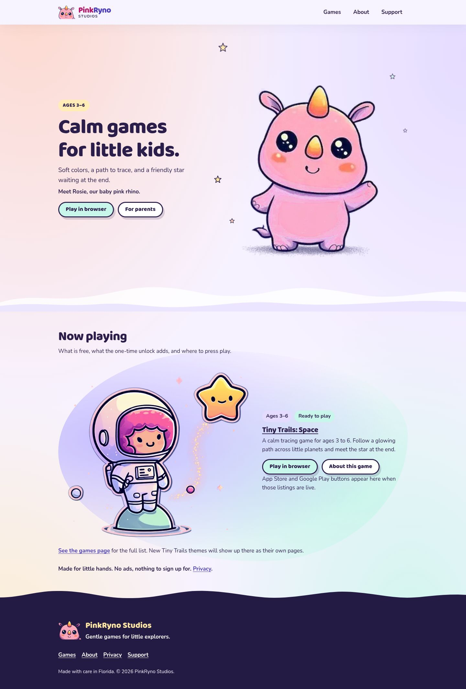 | 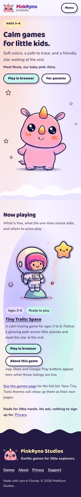 |
| Games | 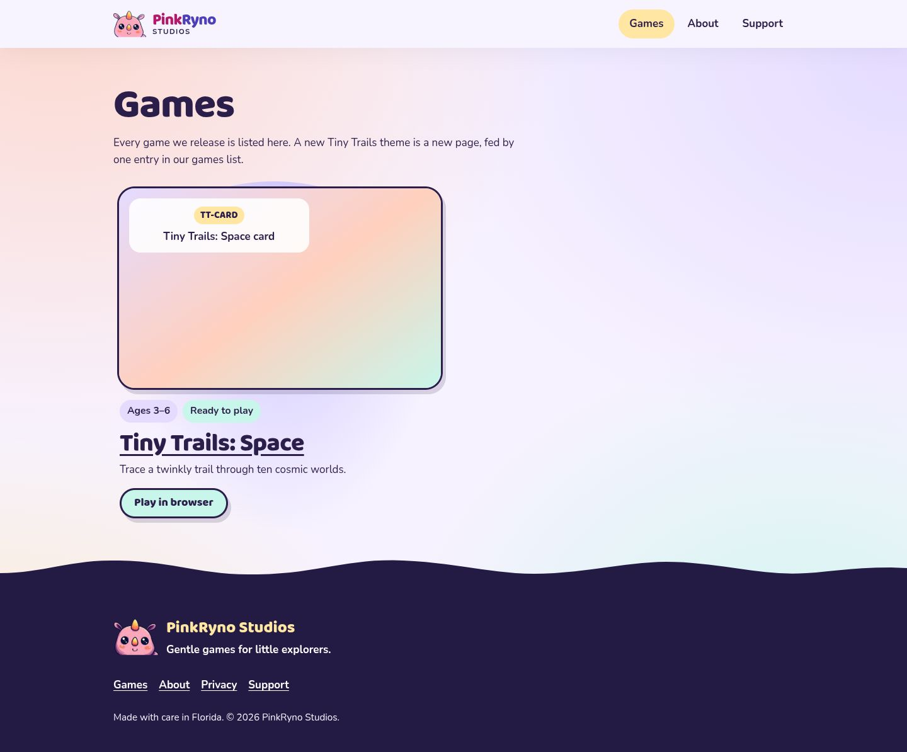 | 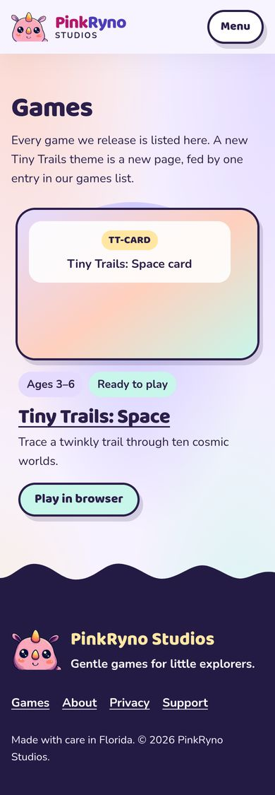 |
| Tiny Trails: Space | 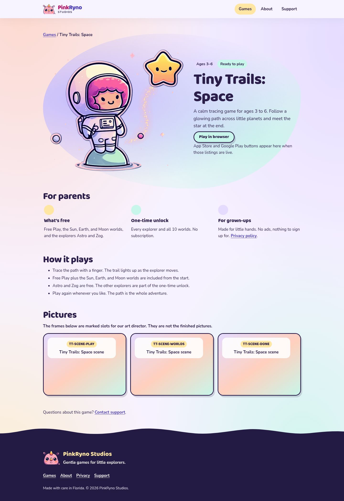 | 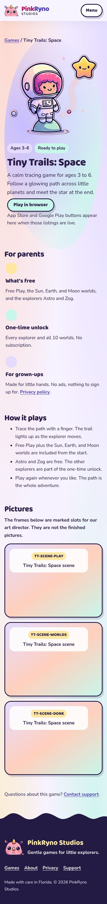 |
| About | 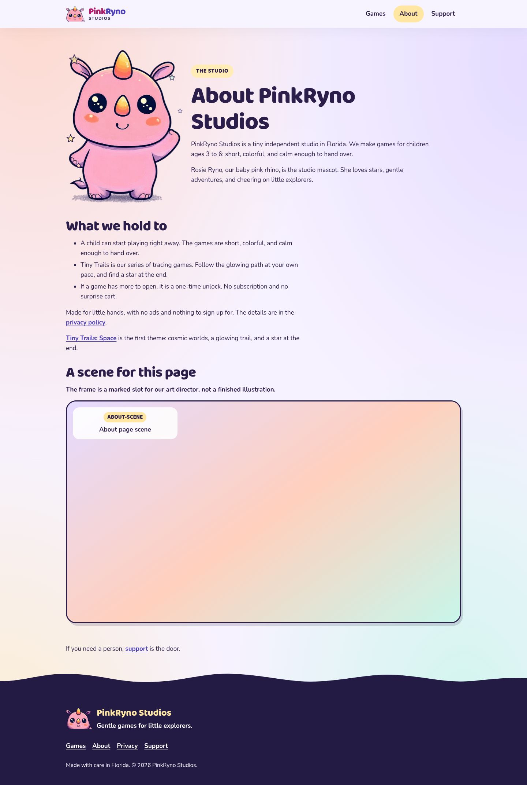 | 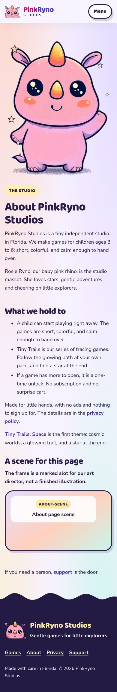 |
| Support | 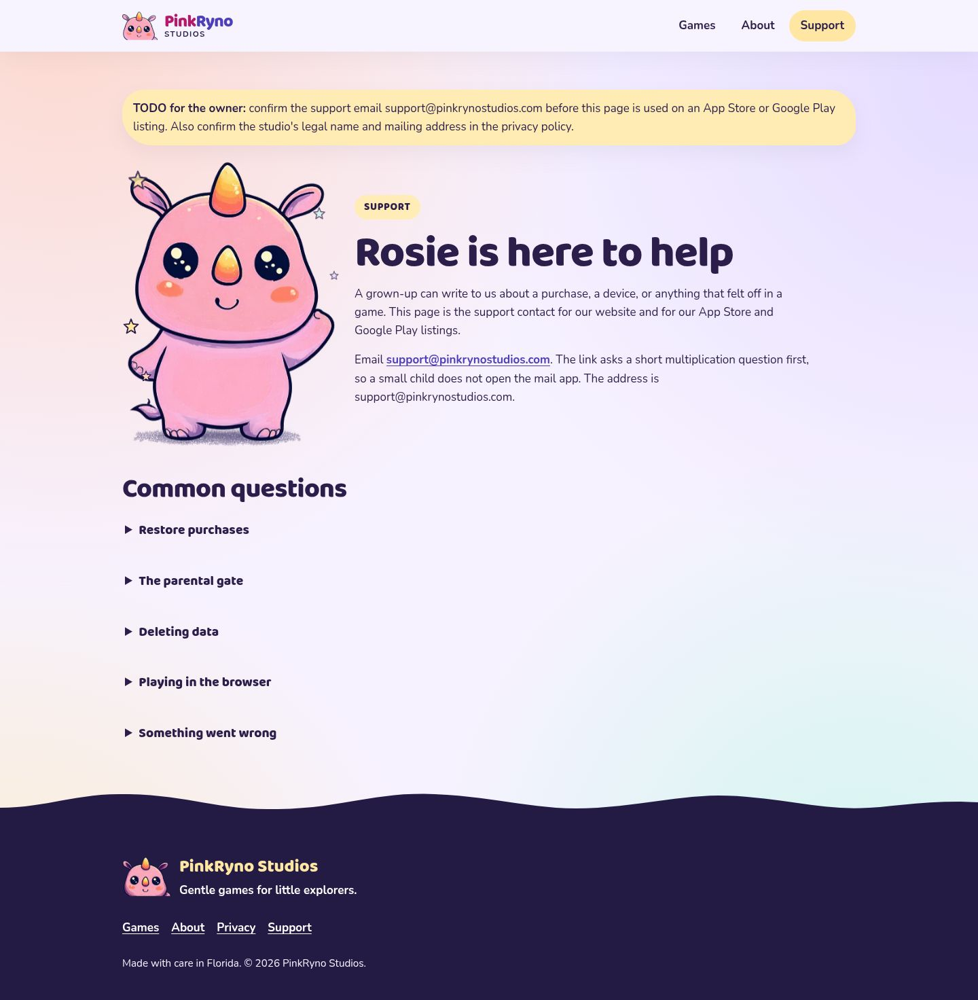 | 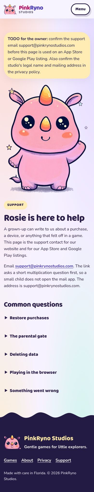 |
| Privacy | 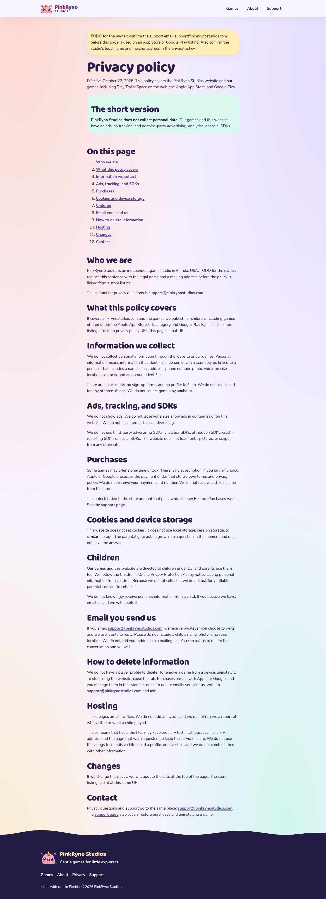 | 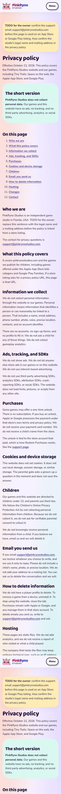 |
| 404 | 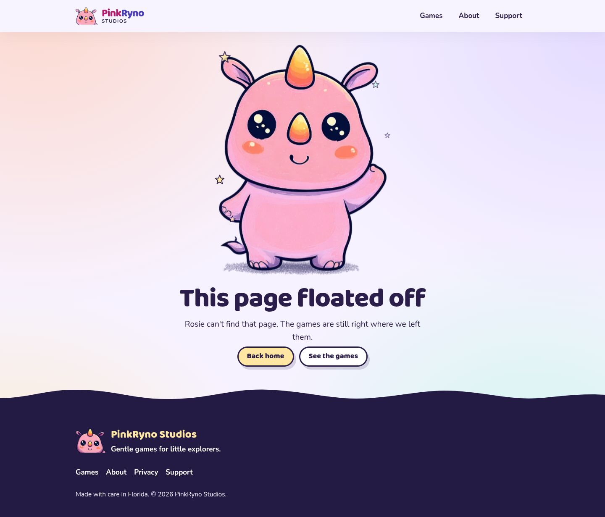 | 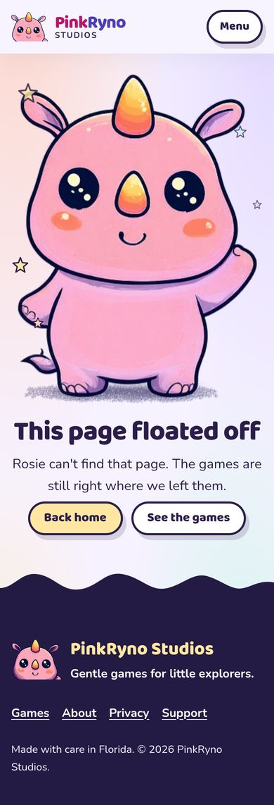 |
| /games/space-maze/ (live game) | 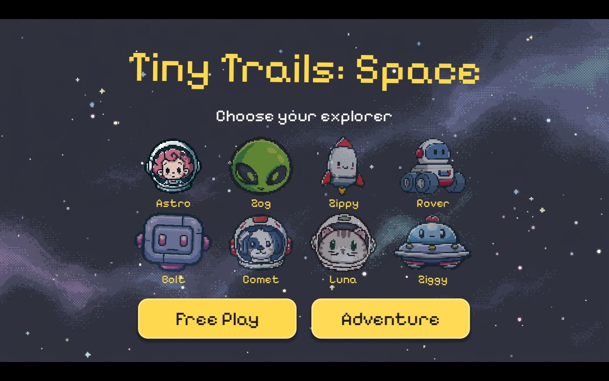 | 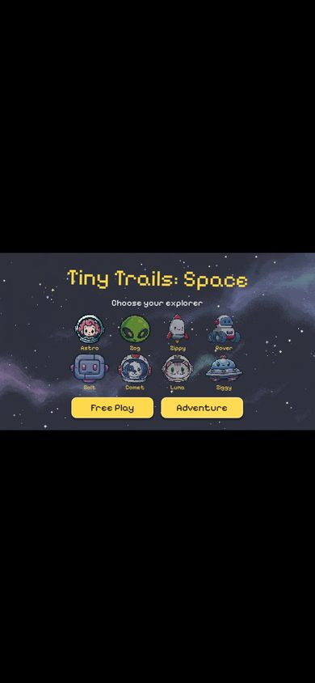 |
| /games/tiny-trails-beta/ (unlisted) | 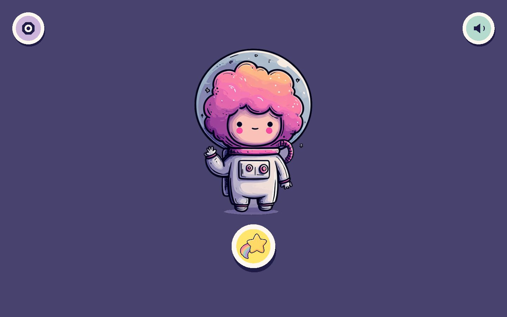 | 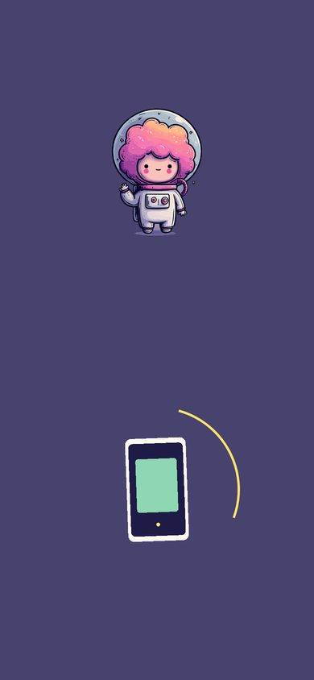 |

## Findings by area

### 1. Visual design

- **Generic SaaS-pastel template.** Four corner radial gradients (peach, lavender, mint, butter) wash every page the same way. Nothing on the page says "cosmic": no deep-space color, no planets, no trail. The only cosmic art is the Tiny Trails hero. 
- **Rosie's art isn't the sticker style.** The hero Rosie is soft, painterly, and grainy with an airbrushed ground shadow. The game key art (Astro) is flat cel shading with plum outlines. Side by side on Home they read as two different artists.
- **Stars attached to Rosie (preference violation).** `render-site.mjs` injects `SPARK` (five outlined stars) into every `.mascot-stage`, and `site.css` animates them with `floaty` at 4.2 s. They sit at fixed spots hugging her outline, so they read as part of her. See the About and 404 shots. 
- **Big dead zones.** The hero leaves about 40% of the 1440 width empty to the left of Rosie, and on desktop "Now playing" has the art and text floating inside a big soft blob. The page ends after one game, followed by a large footer.
- **The navy footer is the only strong color moment,** and it comes after the content. The deep plum and navy should be part of the scene, not just the floor.

### 2. Hierarchy and copy

- **H1 "Calm games for little kids."** is fine, but the lede, the "Meet Rosie" line, and two buttons all compete at once. "For parents" goes to About, which isn't really a parents' page.
- **Copy that talks about the website instead of the game:** "What is free, what the one-time unlock adds, and where to press play." / "App Store and Google Play buttons appear here when those listings are live." / "New Tiny Trails themes will show up there as their own pages." / "Every game we release is listed here. A new Tiny Trails theme is a new page, fed by one entry in our games list." / "If you need a person, support is the door." / "A scene for this page… The frame is a marked slot for our art director."
- **Support copy explains the parental gate mechanism** ("The link asks a short multiplication question first… The address is support@…") and repeats the email address three times.
- **"Ready to play"** chip and "Ages 3–6" appear as chips *and* in the eyebrow *and* in the body text on the same screen.

### 3. Structure and navigation

- Nav: Games, About, Support. Privacy is only in the footer, which is fine, but there's **no clear parent path** (what is it, is it safe, what does it cost, how do I get it).
- **Games index with a single game** is an extra click that shows a placeholder card. Home already spotlights the same game.
- **"Play in browser" drops the parent into a full-screen Godot export** (`/games/space-maze/`, 24 MB) with no header, no back link, no loading note, no title or meta, and no `h1`.
- No store badges yet (correct, since the listings don't exist), but the empty space is filled with an apology sentence instead of a "Coming to iPhone, iPad and Android" line.

### 4. Boxes and cards (owner dislikes "lots of boxes")

Visible rounded, filled or outlined elements per page (desktop), from the audit script:

| Page | Boxes | What they are |
| --- | --- | --- |
| Home | 7 (8 mobile) | 4 outlined pill buttons, eyebrow pill, 2 chips, plus the blob behind the spotlight |
| Games | 7 | placeholder frame, label card, slot-ID pill, 2 chips, button, card |
| Tiny Trails: Space | **13** | 3 placeholder frames, each with a label card and an ID pill, 2 chips, button, spotlight blob, 3 dot-icon fact columns |
| About | 5 | eyebrow pill, big placeholder frame, label card, ID pill |
| Support | 3 + 5 FAQ rows | yellow TODO box, eyebrow pill, `details` rows |
| Privacy | 2–3 | yellow TODO box, "short version" panel |

Almost every heading has a pill above it, and every badge is a chip. A store-grade kids' site would use about 1–2 framed things per screen at most.

### 5. Mascot treatment

- ✅ No box or frame around Rosie, and `.mascot-stage img` explicitly strips borders and backgrounds.
- ❌ Five outlined stars attached around her on Home, About, Support, and 404 (see above).
- ❌ On About, Support, and 404, the same full-body pose is used with a bob animation and an airbrushed ground shadow, so it's repeated rather than giving each page a moment (waving, helping, puzzled).
- ❌ On Support (mobile), Rosie takes up the whole first screen *after* a TODO banner, which pushes the actual help below the fold. 
- ❌ The animated hero is upscaled about 1.55× on desktop and about 1.85× on 2× phones, so she looks soft next to the crisp key art.

### 6. Mobile

- Home: the H1, lede, buttons, then Rosie at about 460 px tall, so the game appears only at about 1.4 screens down. 
- Tiny Trails page is 3,267 px tall on mobile, and about 900 px of that is the three empty placeholder frames.
- The Menu button is an outlined pill, so it's yet another box in the header.
- No horizontal overflow at 390 px. Buttons meet 44×44. The only targets under 44 px are inline text links (allowed under WCAG 2.5.8), but Privacy has 18 of them in a dense TOC and body.

### 7. Performance

| Page | Requests | Transfer (cold) | Notes |
| --- | --- | --- | --- |
| Home | 11 | **1.59 MB** | Rosie's original wave loop, 1.35 MB (49 frames, 386×500) |
| Games | 9 | 99 KB | |
| Tiny Trails: Space | 10 | 242 KB | `hero.webp` 142 KB at 713×656, lazy on Home |
| About / Support / 404 | 10 | ~172 KB | `rosie-full.webp` 72 KB |
| Privacy | 9 | 101 KB | |
| /games/space-maze/ | 7 | 24.1 MB | Godot: 14.8 MB `.pck` + 9.1 MB `.wasm` |
| /games/tiny-trails-beta/ | 8 | 17.4 MB | Godot: 9.8 MB `.wasm`, 4.6 + 2.9 MB `.pck` |

Lighthouse 12 (home page, mobile and desktop presets): **Performance 100, Accessibility 100, Best Practices 96, SEO 100.** Mobile LCP 1.2 s, CLS 0, TBT 0 ms. Flagged: low-resolution images (the upscaled Rosie), about 1.5 MB of image-delivery savings, short cache TTL (GitHub Pages default of 10 min, which we can't change), and the preload/LCP discovery chain.

So the speed is fine on fast connections. The issue is **weight**: one decorative animation costs about 10× the rest of the page. The PNG fallbacks (`rosie-full.png` 253 KB, `rosie-social.png` 255 KB) are never downloaded by modern browsers, but `pinkrynostudios-mascot.png`, `assets/images/bubbles-*`, and the old rhino files are dead weight in the repo.

There's no "this game is about 24 MB, best on Wi-Fi" note before the browser game.

### 8. Accessibility

- Automated checks are clean: every image has alt text (decorative heads use `alt=""`), there's a skip link, `lang="en"`, visible focus rings, `prefers-reduced-motion` honored (it swaps to a still WebP and stops the stars and bob), and no text failed contrast against a solid background (472 elements checked).
- Manual issues:
  - **Placeholders announced to screen readers:** "Illustration not added yet. Slot TT-SCENE-PLAY…" (`role="img"`).
  - **Hidden gate dialog headings** are in the DOM (`h2` "A grown-up can continue" on every page). They're hidden, but they put a stray `h2` in the outline for some tools.
  - About 50% of the text sits on gradient washes, so contrast can't be fully verified by script. Visually it's fine today, but the redesign should keep text on solid fills.
  - On Home the card title is an `h3` linked heading, while on Games it's an `h2`, so the card level is inconsistent.
  - The game pages (`/games/space-maze/`, beta) have no `h1`, no description, and no canonical tag. They're exports, so this is expected, but a parent landing there from a share link gets a bare page.
  - Long alt text on the hero (`Astro, a chibi astronaut with pink curly hair, standing on…`) is good, but the mascot alt "Rosie Ryno the pink rhino, PinkRyno Studios mascot" is repeated on every page.

### 9. SEO and meta

- Good: unique titles and descriptions, canonical tags, OG and Twitter tags, Organization JSON-LD, a sitemap, robots.txt excludes the beta, and a strict CSP.
- Gaps:
  - **The share image is WebP** (`rosie-social.webp`). Most platforms accept it, but some older iMessage, Slack, and LinkedIn crawlers prefer PNG or JPEG. It's also just Rosie on a flat color with no name or game, so it doesn't sell anything.
  - **Every page shares the same OG image,** including the game page, which should show the game.
  - No `SoftwareApplication` / `VideoGame` JSON-LD for Tiny Trails: Space (age range, price model, platform).
  - `sitemap.xml` lastmod is hard-coded (`UPDATED = "2026-10-22"`).
  - The game export pages have no meta at all.

### 10. Trust signals for parents

What a parent of a 3–6-year-old looks for, and what we show today:

| Signal | Today |
| --- | --- |
| Real screenshots of the game | ❌ Three empty placeholder frames |
| What's free vs. paid, and the price | ⚠️ Free/unlock explained, no price |
| Ages and how a session plays | ✅ Ages 3–6, tracing |
| Who made it | ⚠️ "Tiny independent studio in Florida", no person or story |
| Contact | ✅ Email with parental gate |
| Privacy | ✅ but repeated about 5×, and the Privacy page shows a TODO banner and placeholder legal-name sentence |
| Polish | ❌ TODO notes, art slots, and copy about the site itself make it look unfinished |
| Store presence | ➖ Not live yet. Fine, but needs a confident "coming soon" line |

The TODO banners and unfilled legal name on Privacy are the biggest trust risk: that URL is meant to be the App Store / Google Play privacy-policy link.

## What's already good (keep it)

- Static HTML from `games.json` / `site.json` via `render-site.mjs`, with no build tooling, no third-party requests, and self-hosted fonts.
- A parental gate on links that leave the site.
- Reduced-motion support, the skip link, and focus styles.
- The Baloo 2 + Nunito pairing, and the plum ink color `#2B1E4A`.
- The Tiny Trails key art (`hero.webp`), cut out with no frame.
- The 404 concept ("This page floated off").
